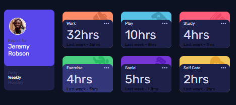

# Frontend Mentor - Time tracking dashboard solution

This is a solution to the [Time tracking dashboard challenge on Frontend Mentor](https://www.frontendmentor.io/challenges/time-tracking-dashboard-UIQ7167Jw). Frontend Mentor challenges help you improve your coding skills by building realistic projects.

## Table of contents

- [Overview](#overview)
  - [The challenge](#the-challenge)
  - [Screenshot](#screenshot)
  - [Links](#links)
- [My process](#my-process)
  - [Built with](#built-with)
  - [What I learned](#what-i-learned)
  - [Continued development](#continued-development)
  - [AI Collaboration](#ai-collaboration)
- [Author](#author)

## Overview

### The challenge

Users should be able to:

- View the optimal layout for the site depending on their device's screen size
- See hover states for all interactive elements on the page
- Switch between viewing Daily, Weekly, and Monthly stats

### Screenshot



### Links

- Solution URL: [Add solution URL here](https://github.com/abdiabduljebar16-ship-it/time-tracking-dashboard)
- Live Site URL: [Add live site URL here](https://abdiabduljebar16-ship-it.github.io/time-tracking-dashboard/)

## My process

### Built with

- Semantic HTML5 markup
- CSS custom properties
- Flexbox
- CSS Grid
- Mobile-first workflow
- Vanilla JavaScript

### What I learned

I learned in this project mainly about how to fetch data and render it to the page.
Actually fetching data and displaying on one element is easy but renderiring it too many element at once is a bit tricky. Below is my code to do that;

```js
const daily = document.querySelector(".daily");
const currentTime = document.querySelectorAll(".timeParagraph");
const previousTime = document.querySelectorAll(".updatedParagraph");
daily.addEventListener("click", async (event) => {
  const response = await fetch("data.json");
  if (!response) {
    throw new Error("the data did not fetched");
  }
  const users = await response.json();
  users.forEach((user, index) => {
    currentTime[index].textContent = `${user.timeframes.daily.current}hrs`;
    previousTime[index].textContent =
      `Yestarday - ${user.timeframes.daily.previous}hrs`;
  });
});
```

The main part is using index in forEach and querySelectorAll()

### Continued development

I will continue to develop projects on fetching and rendering data on page and focus on array methods.

### AI Collaboration

I used ChatGpt to give me hints on what i built and to remember concepts i forget.

## Author

- Website - [Abdi Abduljebar](https://abdiabduljebar16-ship-it.github.io/portfolio/)
- Frontend Mentor - [@abdiabduljebar16-ship-it](https://www.frontendmentor.io/profile/abdiabduljebar16-ship-it)
